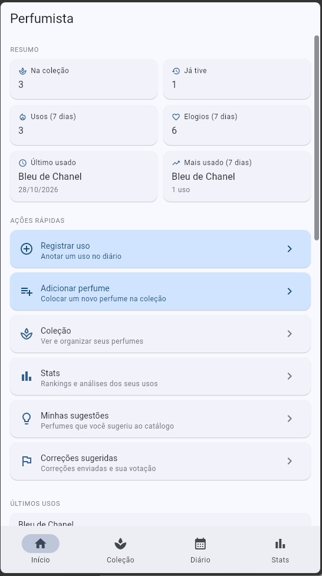
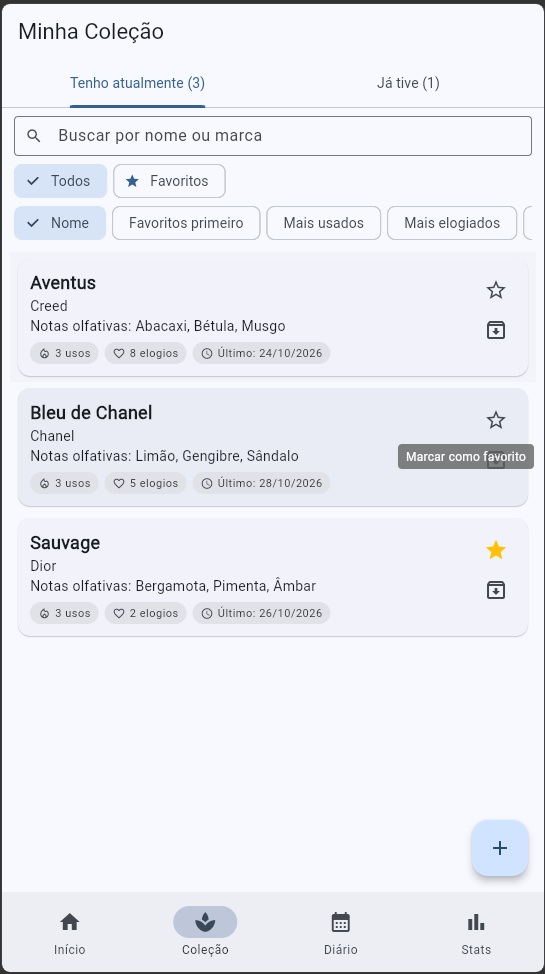
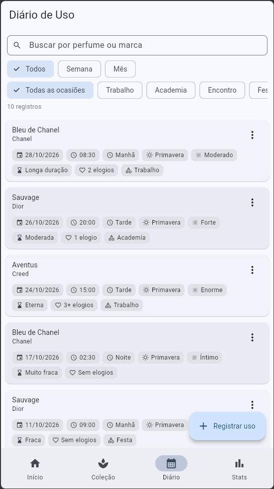
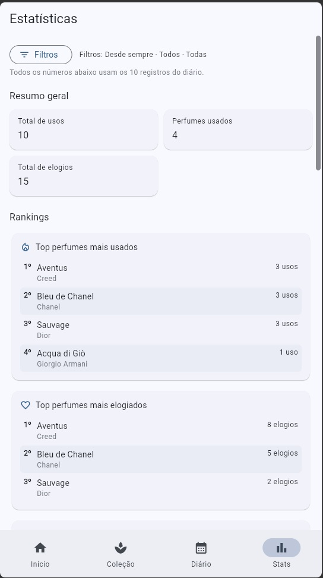
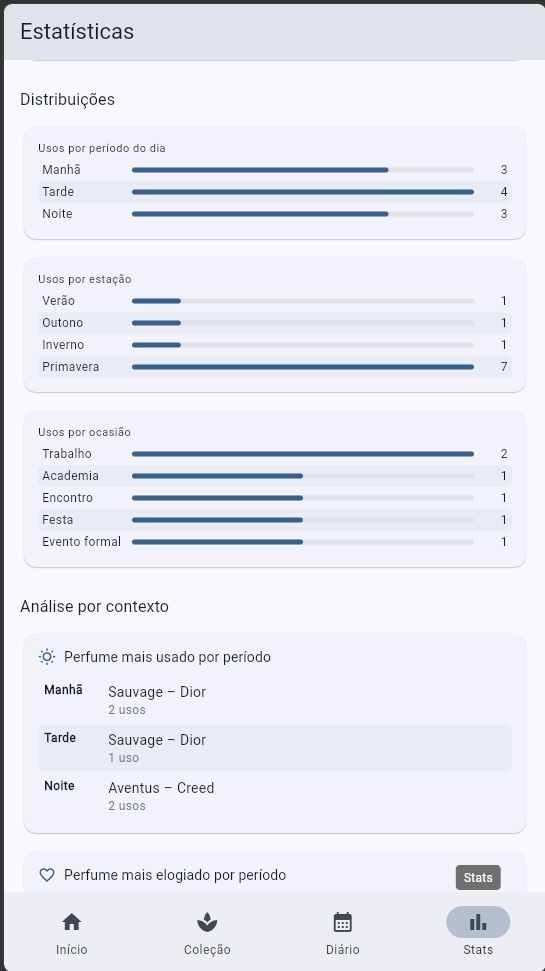
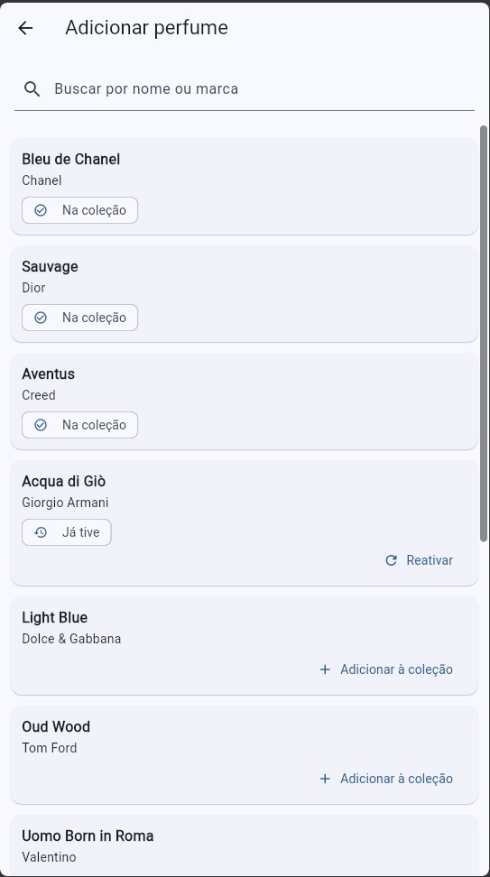
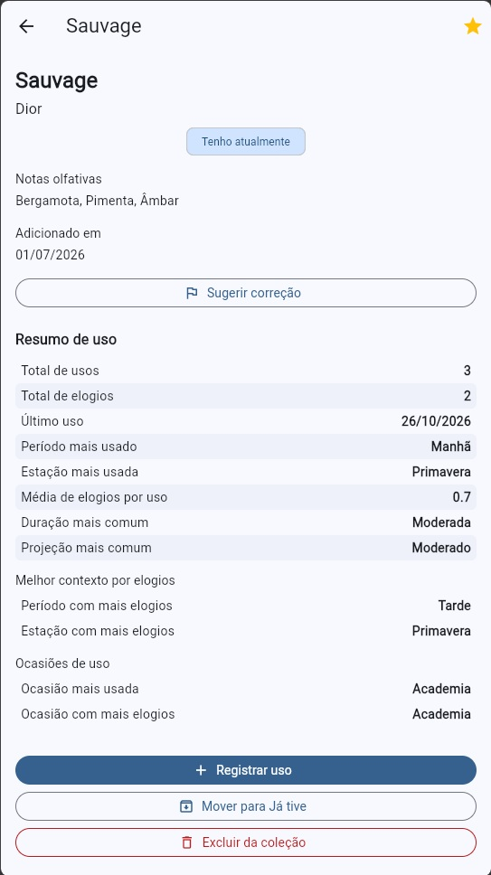

# Perfumista

Perfumista is a Flutter application for managing a personal fragrance collection, tracking real-world perfume usage, and turning those records into useful personal insights.

The project was designed as a local-first product prototype with a strong focus on usability, data consistency, responsive mobile layouts, and maintainable feature flows.

> **Source code is private.**  
> Perfumista is intended to become a commercial product, so this public repository is used only to showcase the project, its current capabilities, and selected screenshots.

---

## Overview

Perfumista helps users organize the fragrances they own, record when and how they use them, and analyze their habits over time.

The current version includes collection management, a detailed usage diary, personal statistics, favorites, local fragrance suggestions, community-style correction voting prototypes, backup and restore, and contextual recommendations based on the user's own usage history.

All current user data is stored locally on the device.

---

## Key Features

### Fragrance Collection
- Add fragrances to a personal collection
- Search by fragrance name or brand
- Mark fragrances as favorites
- Sort by name, usage, compliments, recent usage, or favorites
- Move fragrances to a **Previously Owned** section
- Reactivate previously owned fragrances
- Remove fragrances that were added by mistake
- Preserve historical diary entries even when a fragrance is removed from the collection
- Prevent duplicate collection entries

### Usage Diary
- Register perfume usage with date and time
- Edit and delete existing usage records
- Track:
  - projection
  - longevity
  - compliments
  - season
  - time of day
  - occasion
- Automatic season and time-of-day classification
- Filter diary records by period and occasion
- Search records by fragrance name or brand
- Keep historical entries for fragrances no longer in the active collection

### Personal Statistics
- Total usage and compliment summaries
- Most-used fragrances
- Most-complimented fragrances
- Most-used brands
- Contextual analysis by:
  - time of day
  - season
  - occasion
- Per-fragrance projection and longevity distributions
- Filters for:
  - week
  - month
  - all time
  - morning / afternoon / night
  - season
- Responsive ranking and analysis cards

### Fragrance Details
- Usage count
- Compliment count
- Last usage
- Most common usage period
- Most common season
- Most common occasion
- Most common projection
- Most common longevity
- Contexts associated with the highest number of compliments
- Quick access to register a new usage

### Favorites
- Mark fragrances in the collection as favorites
- Filter the collection by favorites
- Prioritize favorites in selected personal recommendation flows

### Personal Recommendations
- **For Today** recommendations generated from local usage history
- Recommendations consider available local signals such as:
  - current time of day
  - season
  - favorites
  - previous compliments
  - usage context
- No external AI service is required for this feature

### Local Fragrance Suggestions
- Suggest fragrances that are not yet available in the local catalog
- Create suggestions without automatically adding them to the collection
- Edit locally created fragrance suggestions
- Add a suggested fragrance to the collection later
- Track suggestion status:
  - suggestion only
  - in collection
  - previously owned
- Prevent duplicate suggestions using normalized fragrance name and brand

### Correction Suggestions & Voting
- Suggest corrections for catalog fragrances
- Compare the original fragrance information with the proposed correction
- Vote **Agree** or **Disagree**
- Change an existing vote
- Visual voting progress bar
- Correction statuses:
  - Pending
  - Eligible for approval
  - Rejected
- Filtering by correction status
- The original catalog entry is not automatically modified by voting

Current voting rules used by the prototype:
- Minimum of 10 total votes
- At least 70% agreement for an eligible correction
- At least 60% disagreement for rejection
- Minimum voting period of 7 days

### Backup & Restore
- Export all local app data as JSON
- Copy the backup for manual storage
- Restore data from a previous backup
- Validate imported JSON before replacing current data
- Reject invalid or incompatible backups without deleting existing data
- Local schema/version handling for backward compatibility

### Data Safety & Compatibility
- Local schema versioning
- Compatibility handling for older saved data
- Safe defaults for newer fields
- Protection against malformed local records
- Duplicate prevention
- Stable ID handling for local entities

### Responsive UI
- Mobile-oriented layouts
- Responsive cards, filters, chips, voting bars, and statistics
- Tested with narrow viewport sizes during development
- Separate development-only tools hidden from release builds

---

## Tech Stack

- **Flutter**
- **Dart**
- **SharedPreferences** for local persistence
- **Material Design**
- Flutter Web for development and responsive testing
- Android APK builds for mobile distribution/testing
- Automated unit and widget tests

The project currently follows a local-first architecture. No production backend, authentication system, or cloud synchronization is included in the current public feature set.

---

## Testing & Quality

The project includes automated coverage for core business rules and regression scenarios, including:

- collection lifecycle
- previously owned fragrances
- diary persistence
- favorites
- occasions
- statistics filters
- duplicate prevention
- fragrance suggestions
- correction voting
- voting status calculation
- backup validation
- data migration
- home insights and recommendations

The project has been maintained with:

- `flutter analyze`
- `flutter test`
- Android debug builds
- Android release builds

At the latest development checkpoint, the automated suite contained **150+ passing tests**.

---

## Screenshots

### Home

### Collection

### Daily Usage

### Usage Diary

### Statistics

### Suggestions

### Fragrance Details

---

## Project Status

Perfumista is currently in active development.

The current build is suitable for local testing and portfolio demonstration. Core flows are implemented and tested, while production infrastructure such as cloud synchronization, authentication, and backend services is intentionally outside the current version.

---

## Why the Source Code Is Private

Perfumista is being developed with the intention of becoming a commercial product.

For that reason, the implementation repository is private. This public portfolio repository focuses on:

- product scope
- implemented functionality
- UI screenshots
- technical decisions
- development progress

No proprietary source code, credentials, secrets, or confidential implementation details are included here.

---

## Disclaimer

Perfumista is an independent software project. Brand names and fragrance names that may appear in screenshots or test data belong to their respective owners.
